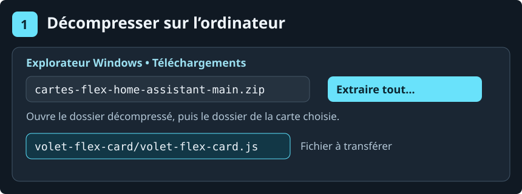
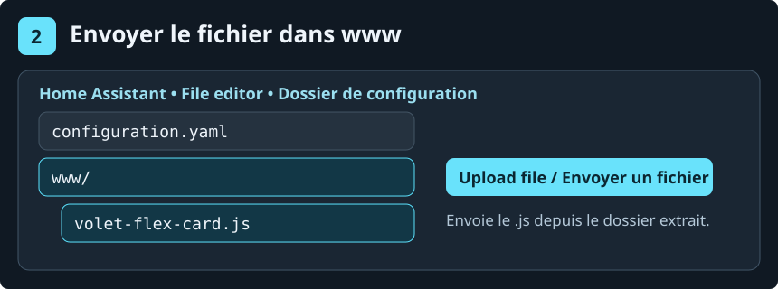
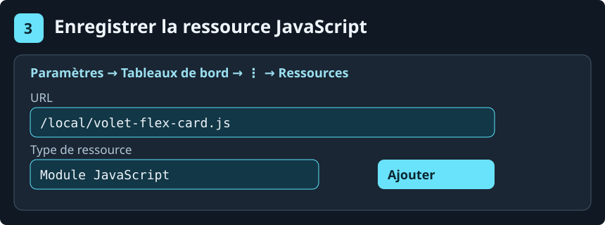
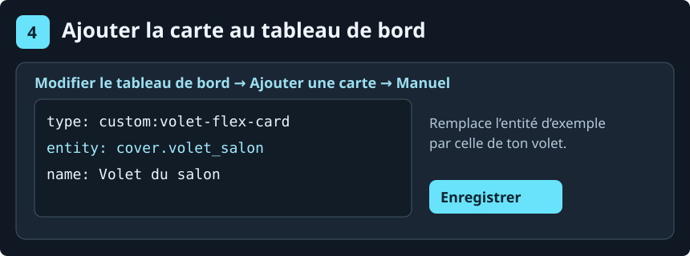

# Installer les Cartes Flex depuis le ZIP

Ce guide prend **Volet Flex** comme exemple. Les images sont des vues reconstituées pour repérer les bons boutons.

## 1. Décompresser le ZIP sur ton ordinateur

[Télécharge le ZIP des cinq cartes](https://github.com/jfk84/cartes-flex-home-assistant/archive/refs/heads/main.zip). Sous Windows, fais un clic droit sur le ZIP, puis choisis **Extraire tout…**. Dans le dossier extrait, ouvre `volet-flex-card` et repère `volet-flex-card.js`.



## 2. Copier le fichier .js dans Home Assistant

Ouvre **File editor** dans Home Assistant. Clique sur l’icône **Dossier** et repère le dossier qui contient `configuration.yaml`. Ouvre le sous-dossier **`www`**. Dans ce dossier, clique sur **Upload file** (flèche vers le haut), choisis `volet-flex-card.js` sur ton ordinateur et confirme l’envoi.



Le fichier doit se trouver dans **`/config/www/volet-flex-card.js`**. Tu envoies seulement le fichier **.js** de la carte voulue. Garde le ZIP et les exemples YAML sur ton ordinateur.

Si `www` n’existe pas, crée-le à côté de `configuration.yaml`, puis redémarre Home Assistant une fois. [Documentation Home Assistant sur le dossier www](https://contributors.home-assistant.io/frontend/custom-ui/resources/#serve-the-file)

## 3. Déclarer le fichier comme ressource

Va dans **Paramètres → Tableaux de bord → ⋮ → Ressources → Ajouter une ressource**. Saisis **`/local/volet-flex-card.js`**, choisis **Module JavaScript**, puis valide. Recharge ensuite la page. Si **Ressources** n’apparaît pas, active le **Mode avancé** dans ton profil Home Assistant.



Si cette carte est déjà enregistrée dans **Ressources**, modifie l’entrée existante. Après avoir remplacé un fichier, ajoute ou incrémente `?v=2` à la fin de l’adresse pour rafraîchir la copie du navigateur.

## 4. Ajouter la carte à ton tableau de bord

Ouvre ton tableau de bord, puis **Modifier → Ajouter une carte → Manuel**. Colle l’exemple, remplace `cover.volet_salon` par l’identifiant réel de ton volet et enregistre.



```yaml
type: custom:volet-flex-card
entity: cover.volet_salon
name: Volet du salon
```

| Carte | Fichier à copier dans `www` | URL de la ressource | Exemple |
| --- | --- | --- | --- |
| Boutons Flex | `boutons-flex-card.js` | `/local/boutons-flex-card.js` | [YAML](boutons-flex-card/exemple.yaml) |
| Clim Flex | `clim-flex-card.js` | `/local/clim-flex-card.js` | [YAML](clim-flex-card/exemple.yaml) |
| Garage Flex | `garage-flex-card.js` | `/local/garage-flex-card.js` | [YAML](garage-flex-card/exemple.yaml) |
| Portail Flex | `portail-flex-card.js` | `/local/portail-flex-card.js` | [YAML](portail-flex-card/exemple.yaml) |
| Volet Flex | `volet-flex-card.js` | `/local/volet-flex-card.js` | [YAML](volet-flex-card/exemple.yaml) |
