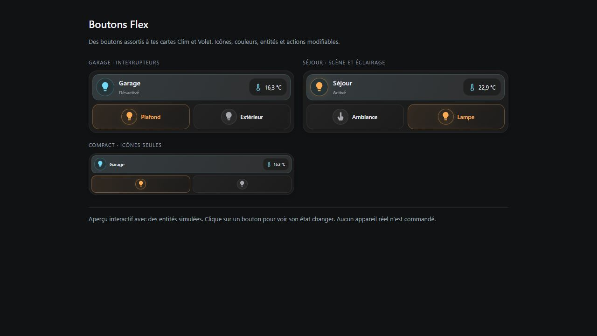
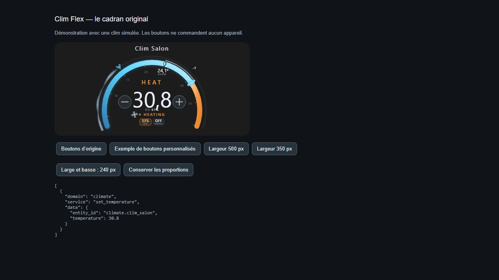
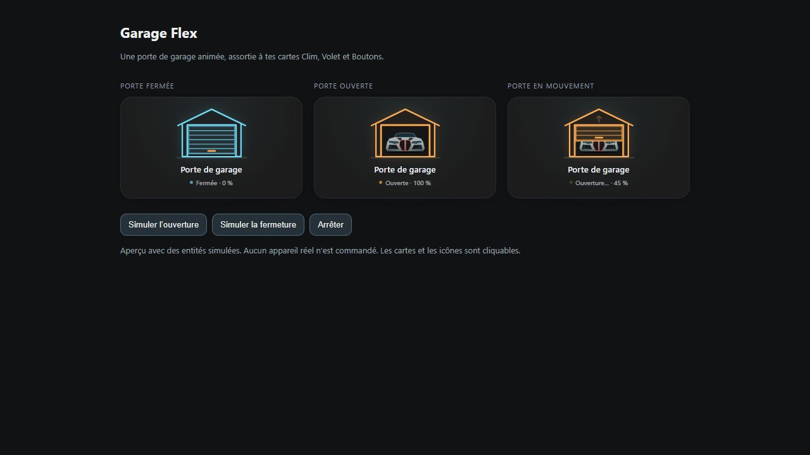
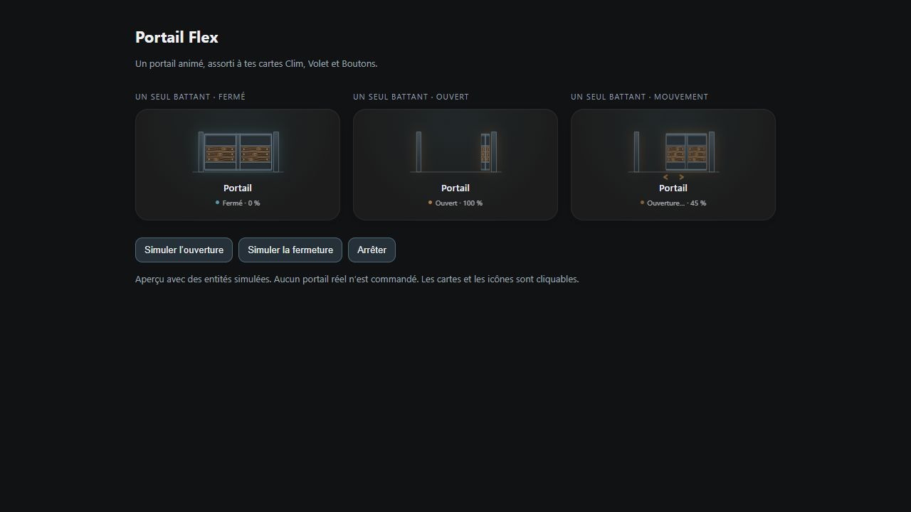
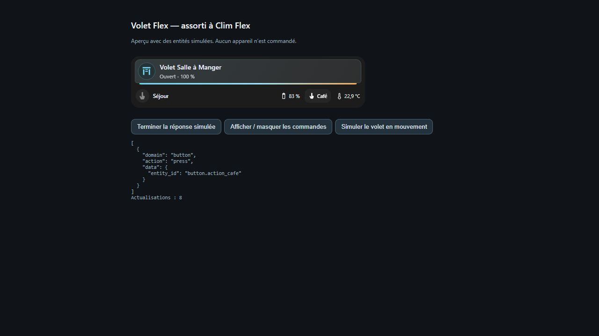

# Cartes Flex pour Home Assistant

Cinq cartes personnalisables pour piloter votre maison depuis vos tableaux de bord.

## Télécharger les cartes

1. Télécharge le ZIP et décompresse-le. Chaque carte a son propre dossier.
2. Pour une installation manuelle, copie le fichier `*-flex-card.js` de la carte choisie dans le dossier `www` de ta configuration Home Assistant.
3. Dans **Paramètres → Tableaux de bord → ⋮ → Ressources**, ajoute le fichier comme **Module JavaScript**. Par exemple, pour Volet Flex, utilise `/local/volet-flex-card.js`. Recharge la page, puis ajoute une carte manuelle avec l’exemple YAML de sa fiche.

## ☕ Soutenir le projet

Les Cartes Flex sont gratuites. Si elles te sont utiles, tu peux soutenir leur développement en m’offrant un café. Merci !

| Carte | Fonction |
| --- | --- |
| [Boutons Flex](./boutons-flex-card/README.md) | Regroupez vos éclairages, interrupteurs, scènes et scripts sur une seule carte. |
| [Clim Flex](./clim-flex-card/README.md) | Pilotez votre chauffage ou votre climatisation depuis un cadran animé. |
| [Garage Flex](./garage-flex-card/README.md) | Visualisez l’ouverture et la fermeture d’une porte de garage animée. |
| [Portail Flex](./portail-flex-card/README.md) | Commandez un portail battant ou coulissant et visualisez son mouvement. |
| [Volet Flex](./volet-flex-card/README.md) | Commandez un volet roulant et regroupez les contrôles de la pièce. |

Chaque carte s’installe séparément depuis **Paramètres → Marketplace → Ajouter depuis un lien**, une fois son dépôt publié sur GitHub. Les pages des cartes contiennent un aperçu et un exemple de configuration.

## Boutons Flex

## Clim Flex

## Garage Flex

## Portail Flex

## Volet Flex

