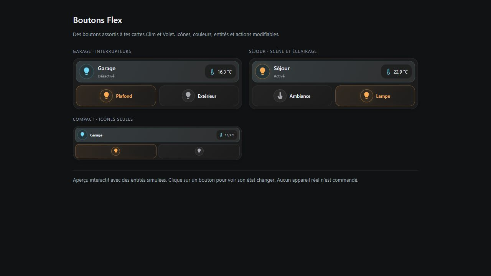

# Boutons Flex

Regroupez vos éclairages, interrupteurs, scènes et scripts sur une seule carte.



Personnalisez les icônes, les couleurs et les actions. Réglez le nombre de colonnes et ajoutez autant de boutons que nécessaire.

<!-- ha-marketplace:exclude-start -->
## Installer dans Home Assistant

1. Ouvrez **Paramètres → Marketplace → Ajouter depuis un lien**.
2. Collez l’URL du dépôt GitHub de Boutons Flex. Connectez GitHub si Home Assistant le demande.
3. Ouvrez la fiche de la carte, installez-la, puis rechargez votre navigateur. Si vos ressources de tableau de bord sont gérées en YAML, ajoutez la ressource indiquée dans la fenêtre d’installation.

Si vous aviez déjà installé la carte manuellement, retirez son ancienne ressource avant de charger la version Marketplace.
<!-- ha-marketplace:exclude-end -->

## Configurer la carte

Dans votre tableau de bord, ajoutez une **carte manuelle** et collez cet exemple. Remplacez les identifiants d’entités par ceux de votre installation.

```yaml
type: custom:boutons-flex-card
entity: switch.lumiere
name: Pièce
columns: 2
sub_buttons:
  - entity: scene.ambiance
    name: Ambiance
    icon: mdi:palette
    show_name: true
```

[Exemple YAML à télécharger](exemple.yaml)
