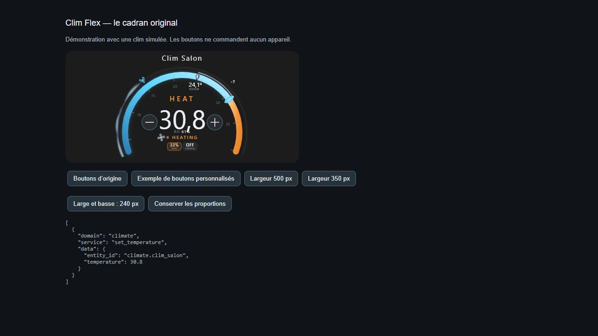

# Clim Flex

Pilotez votre chauffage ou votre climatisation depuis un cadran animé.

## ☕ Soutenir le projet

Les Cartes Flex sont gratuites. Si elles te sont utiles, tu peux soutenir leur développement en m’offrant un café. Merci !

[](https://buymeacoffee.com/jfk84)



Ajustez la température, choisissez les commandes à afficher et redimensionnez le cadran. Les commandes disponibles dépendent de votre entité `climate`.

<!-- ha-marketplace:exclude-start -->
## Installer dans Home Assistant

1. Ouvrez **Paramètres → Marketplace → Ajouter depuis un lien**.
2. Collez l’URL du dépôt GitHub de Clim Flex. Connectez GitHub si Home Assistant le demande.
3. Ouvrez la fiche de la carte, installez-la, puis rechargez votre navigateur. Si vos ressources de tableau de bord sont gérées en YAML, ajoutez la ressource indiquée dans la fenêtre d’installation.

Si vous aviez déjà installé la carte manuellement, retirez son ancienne ressource avant de charger la version Marketplace.
<!-- ha-marketplace:exclude-end -->

## Configurer la carte

Dans votre tableau de bord, ajoutez une **carte manuelle** et collez cet exemple. Remplacez les identifiants d’entités par ceux de votre installation.

```yaml
type: custom:clim-flex-card
entity: climate.thermostat
name: Climatisation
card_width: "100%"
card_height: "280px"
keep_ratio: false
```

[Exemple YAML à télécharger](exemple.yaml)

## Crédits

Clim Flex adapte [Climate Cluster Card](https://github.com/rickyfont94/climate-cluster-card) de rickyfont94. La [licence MIT d’origine](LICENSE) accompagne le code.
