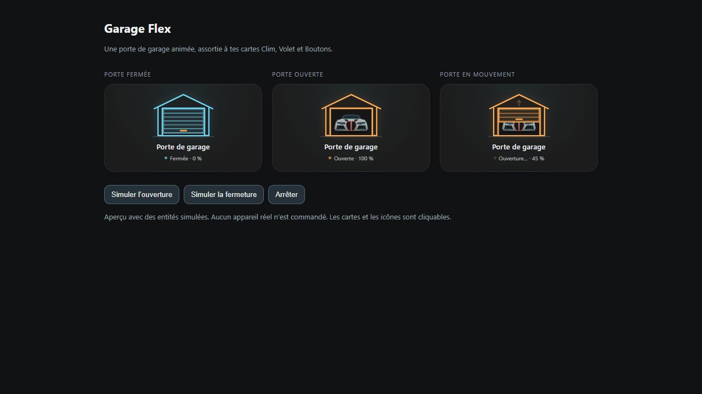

# Garage Flex

Visualisez l’ouverture et la fermeture d’une porte de garage animée.



La porte animée révèle une voiture stylisée à l’ouverture. La carte utilise la position remontée par l’entité quand elle est disponible. Une entité `state_entity` peut fournir le retour d’état séparément.

<!-- ha-marketplace:exclude-start -->
## Installer dans Home Assistant

1. Ouvrez **Paramètres → Marketplace → Ajouter depuis un lien**.
2. Collez l’URL du dépôt GitHub de Garage Flex. Connectez GitHub si Home Assistant le demande.
3. Ouvrez la fiche de la carte, installez-la, puis rechargez votre navigateur. Si vos ressources de tableau de bord sont gérées en YAML, ajoutez la ressource indiquée dans la fenêtre d’installation.

Si vous aviez déjà installé la carte manuellement, retirez son ancienne ressource avant de charger la version Marketplace.
<!-- ha-marketplace:exclude-end -->

## Configurer la carte

Dans votre tableau de bord, ajoutez une **carte manuelle** et collez cet exemple. Remplacez les identifiants d’entités par ceux de votre installation.

```yaml
type: custom:garage-flex-card
entity: cover.porte_garage
name: Porte de garage
height: 145
animation: true
```

[Exemple YAML à télécharger](exemple.yaml)
