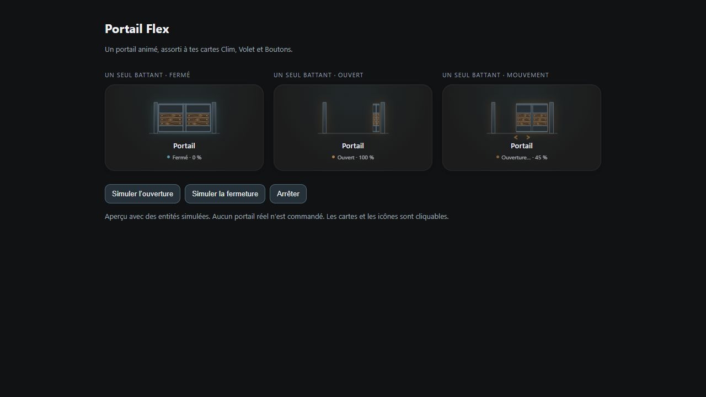

# Portail Flex

Commandez un portail battant ou coulissant et visualisez son mouvement.

## ☕ Soutenir le projet

Les Cartes Flex sont gratuites. Si elles te sont utiles, tu peux soutenir leur développement en m’offrant un café. Merci !

[](https://buymeacoffee.com/jfk84)



Choisissez un battant (`single`), deux battants (`double`) ou un portail coulissant (`sliding`). Pour le modèle à un battant, `hinge_side` choisit le côté des gonds. Une entité `state_entity` peut fournir le retour d’état séparément.

<!-- ha-marketplace:exclude-start -->
## Installer dans Home Assistant

1. Ouvrez **Paramètres → Marketplace → Ajouter depuis un lien**.
2. Collez l’URL du dépôt GitHub de Portail Flex. Connectez GitHub si Home Assistant le demande.
3. Ouvrez la fiche de la carte, installez-la, puis rechargez votre navigateur. Si vos ressources de tableau de bord sont gérées en YAML, ajoutez la ressource indiquée dans la fenêtre d’installation.

Si vous aviez déjà installé la carte manuellement, retirez son ancienne ressource avant de charger la version Marketplace.
<!-- ha-marketplace:exclude-end -->

## Configurer la carte

Dans votre tableau de bord, ajoutez une **carte manuelle** et collez cet exemple. Remplacez les identifiants d’entités par ceux de votre installation.

```yaml
type: custom:portail-flex-card
entity: cover.portail
name: Portail
gate_type: single
hinge_side: right
height: 145
animation: true
```

[Exemple YAML à télécharger](exemple.yaml)
