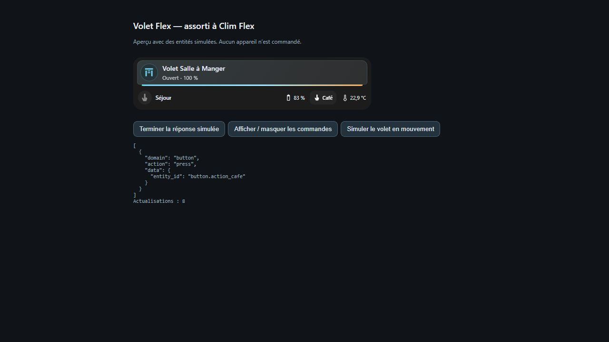

# Volet Flex

Commandez un volet roulant et regroupez les contrôles de la pièce.

## ☕ Soutenir le projet

Les Cartes Flex sont gratuites. Si elles te sont utiles, tu peux soutenir leur développement en m’offrant un café. Merci !

[](https://buymeacoffee.com/jfk84)



Affichez les commandes d’ouverture, d’arrêt et de fermeture, le curseur de position et des raccourcis vers les entités de la pièce.

<!-- ha-marketplace:exclude-start -->
## Installer dans Home Assistant

1. Ouvrez **Paramètres → Marketplace → Ajouter depuis un lien**.
2. Collez l’URL du dépôt GitHub de Volet Flex. Connectez GitHub si Home Assistant le demande.
3. Ouvrez la fiche de la carte, installez-la, puis rechargez votre navigateur. Si vos ressources de tableau de bord sont gérées en YAML, ajoutez la ressource indiquée dans la fenêtre d’installation.

Si vous aviez déjà installé la carte manuellement, retirez son ancienne ressource avant de charger la version Marketplace.
<!-- ha-marketplace:exclude-end -->

## Configurer la carte

Dans votre tableau de bord, ajoutez une **carte manuelle** et collez cet exemple. Remplacez les identifiants d’entités par ceux de votre installation.

```yaml
type: custom:volet-flex-card
entity: cover.volet
name: Volet
height: 110
show_controls: true
sub_buttons:
  - entity: sensor.temperature_piece
    icon: mdi:thermometer
    show_state: true
```

[Exemple YAML à télécharger](exemple.yaml)
